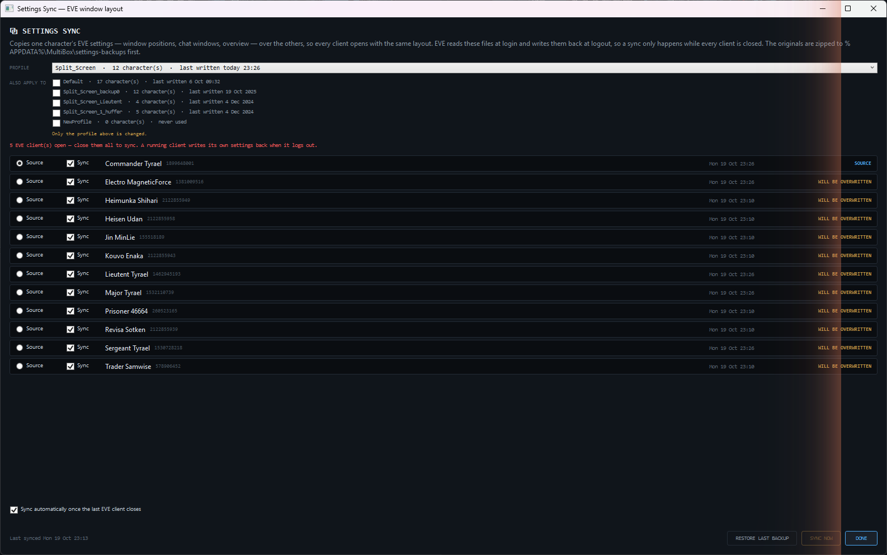
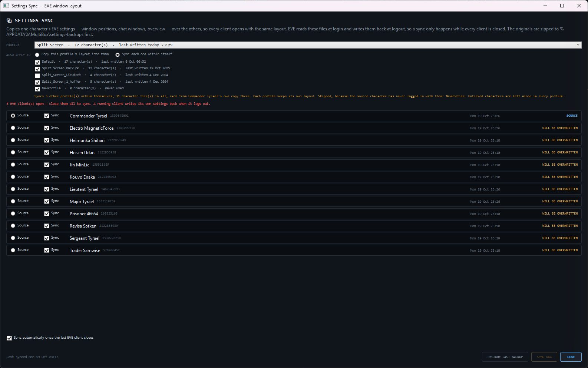

# Sync each profile within itself

**Date:** 2026-10-19

## Description

Settings sync can now keep a different layout per launcher profile. Pick **Sync each one within itself** under *Also
apply to*. Each ticked profile is then synced from the source character's own copy in that profile, so a single-screen
and a split-screen profile both stay consistent inside without one overwriting the other. Before this, ticked
profiles could only receive the selected profile's layout, which would have flattened them all into one.

## Before / After

| Before | After |
| --- | --- |
|  |  |

## Change

- **Core:** `SettingsSyncPlanner` (new) turns the settings into copy steps for either mode and runs them under one
  backup batch, and the window's summary line reads the same plan. `SettingsSyncConfig.Mode` (new key,
  `"CopyInto"` by default, saved by name). A configuration written before this loads unchanged as `CopyInto`.
- **App:** `SettingsSyncService` runs the plan, and auto-sync watches every file the plan touches. The Settings Sync
  window has the two mode buttons, and its summary line names the profiles that will be skipped.
- **EULA boundary:** unchanged. There are no new native calls or outbound hosts. Writes still go only to
  `core_char_<id>.dat` through `CharacterSettingsSync`.
- **Tests:** `SettingsSyncPlannerTests` (13 new; 185 pass) cover:
  - both modes;
  - a profile without the source character, and a missing profile folder;
  - exclusions in every profile;
  - 15 characters per profile;
  - auto-sync seeing a change in another profile;
  - restoring a multi-profile sync;
  - the config round-trip, including an older config.
- **Live clients:** run with 5 clients open against the real profiles (`Split_Screen` selected; `Default`,
  `Split_Screen_backup0`, `Split_Screen_1_huffer` and `NewProfile` ticked). Switching modes and ticking profiles
  updated the summary correctly in both modes (29 files copying, 31 syncing within), and `NewProfile` was reported as
  skipped.
- **Not exercised:** an actual **SYNC NOW** or auto-sync with real files. That needs every client closed, and the
  clients were in use. The copying itself is covered by the tests against temporary folders.
