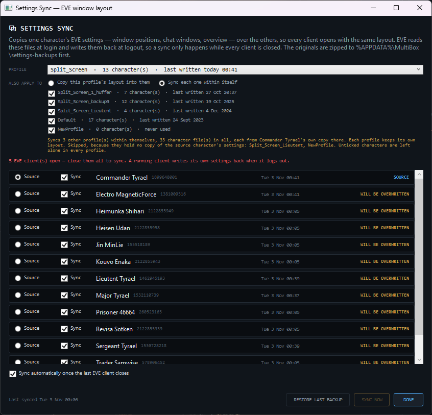
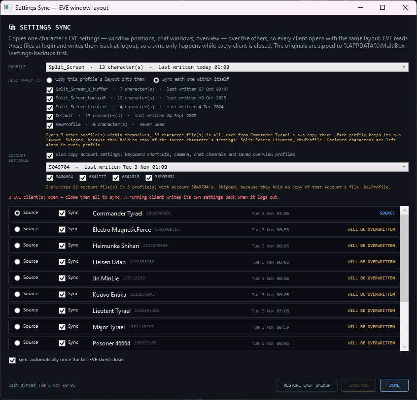

# Keyboard shortcuts in settings sync

**Date:** 2026-11-03

## Description

Settings sync can now copy your keyboard shortcuts to your other accounts. EVE keeps shortcuts per
account rather than per character, so the sync window gains an opt-in that copies one account's
whole settings file over the others.

## Before / After

| Before | After |
| --- | --- |
|  |  |

## Change

- `CharacterSettingsSync.ApplyAccounts` and `BackupAccounts`, `EveSettingsLocator.AccountFiles`, and
  account steps in `SettingsSyncPlanner`. New config keys `SettingsSync.SyncAccountSettings`,
  `SourceAccountId` and `ExcludedAccountIds`.
- New file write: `core_user_<id>.dat`, whole-file copy, opt-in, in the already allow-listed
  `CharacterSettingsSync.cs`. No new native calls or outbound hosts.
- Docs corrected: they said account files hold graphics, audio and hardware values. Reading the
  files shows those are in `core_public__.yaml`, per profile, which is still never touched.
- Shortcuts being in `core_user` comes from the `customCmds` key in real files, not from any CCP
  documentation.
- Tests: 10 added to `SettingsSyncTests`.
- Not exercised: a sync of real files followed by a login in the client, so shortcuts arriving in
  game is unconfirmed by this entry.
