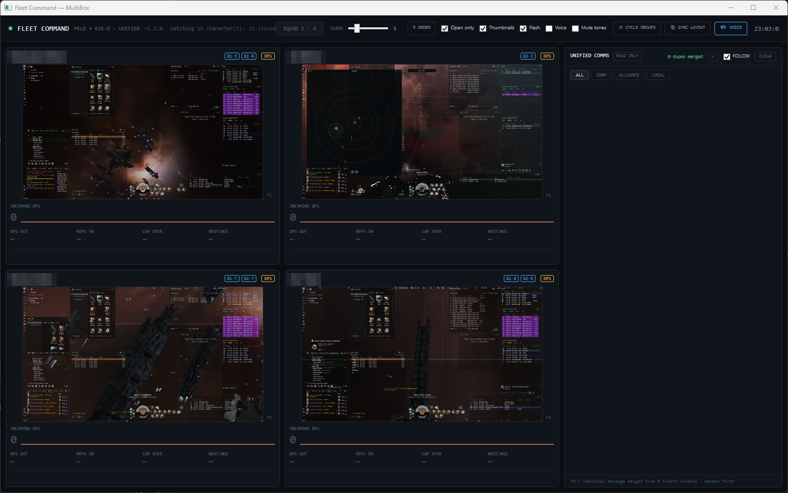

# Logged-off clients stay on the dashboard

**Date:** 2026-11-14

## Description

Logging a character off without closing the client used to make that client disappear from
the dashboard until someone logged back in. Each client sitting at character select now gets a
**Character select** card after the character cards, with its live thumbnail, and clicking it
brings that client to the front.

## Before / After

| Before | After |
| --- | --- |
|  |  |

## Change

- `MultiBox.Core.Model.EveWindowTitle`: the title rules (`EVE - <name>` logged in, bare `EVE`
  at character select) moved out of `EveClientLocator` so they are tested off Windows.
- `EveClientLocator.FindCharacterSelectClients`; `FindClients` and `CountOpenClients` now share
  one window enumeration. Same native calls as before: no new APIs, file writes or hosts.
- `FleetLayout.KeepOrder` keeps the character-select cards in first-seen order, because
  `EnumWindows` reports z-order and would otherwise reshuffle them on every alt-tab.
- `ClientCardViewModel` base for anything on the grid; `IdleClientCardViewModel` and the
  `IdleClientCard` template. Character-select cards get no F-key label and cannot be dragged.
- The grid now notices when the set of cards changes at the same count (a character logging
  off swaps one card for another); it used to compare counts only.
- Status line adds "N at character select."
- Tests: `IdleClientTests`, 28 cases. Full suite 227/227.
